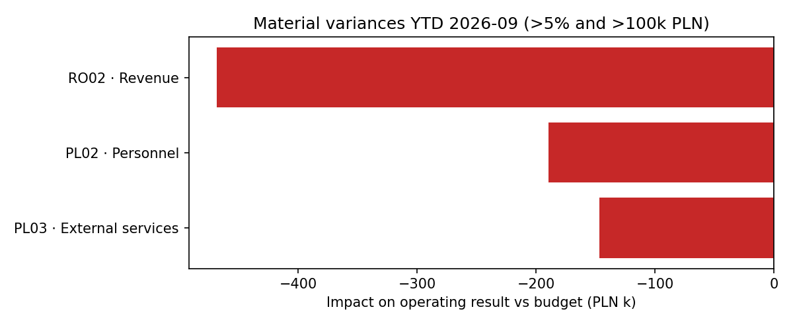

# Budget vs Actual: variance analysis and full-year forecast

A month-end FP&A workflow for a group of five companies (three in Poland, two in Romania), built in Python and SQL on synthetic data.

It answers the three questions a CFO asks after each close:

1. **Is the data complete?** Every GL posting must map to a budget line. Unmapped postings are reported, never dropped.
2. **Where are we off budget, and does it matter?** A variance is flagged only when it is both above 5% and above 100k PLN.
3. **Where will we land for the year?** Full-year forecast = YTD actuals + remaining budget × the actual/budget ratio of the last three months.



## Findings (YTD September 2026, PLN thousands)

| Entity · line | Budget | Actual | Variance | Impact |
| --- | ---: | ---: | ---: | --- |
| RO02 · Revenue | 4,411 | 3,942 | −469 (−10.6%) | Revenue down ~15% since April; full-year result falls from +576 to −35 |
| PL02 · Personnel | 2,268 | 2,457 | +189 (+8.4%) | Over budget from January: a structural cost, not a one-off |
| PL03 · External services | 1,080 | 1,227 | +147 (+13.6%) | Jumped ~35% from June; recent trend points to +255 over budget by year-end |

- **Group operating result:** forecast 3,837 vs budget 4,752, a gap of −915 (−19%).
- **Data quality:** 73 in postings on account `409900` (PL01, Jul–Sep) are missing from the budget mapping. This needs classifying before the numbers go to the Board.
- **Why both thresholds:** a 5% rule alone flags small, noisy lines. A 10% rule alone misses PL02 Personnel, the second-largest hit to profit.

## How it works

| Step | File | What it does |
| --- | --- | --- |
| Data | `generate_data.py` | Synthetic GL (11 accounts), monthly budget, account mapping; three planted issues plus one unmapped account |
| SQL | `sql/01–04_*.sql` | Unmapped accounts, YTD variance (CTEs), top cost overrun per entity (`RANK()`), monthly trend with running YTD and MoM change (`SUM() OVER`, `LAG()`) |
| Python | `fpa/variance.py` | Mapping with a many-to-one check, variance with favourable/unfavourable logic, seasonality-aware forecast |
| Report | `report.py` | Runs the SQL on in-memory SQLite, builds an Excel report (8 sheets) and the chart |
| Tests | `tests/` | 9 tests, including a check that the SQL and pandas results reconcile to 0.1k PLN |

## Run it

```bash
python3 -m venv .venv && source .venv/bin/activate
pip install -r requirements.txt
python generate_data.py
python report.py            # writes output/variance_report.xlsx and output/flagged_variances.png
pytest
```

All data is synthetic. No company data is used.
